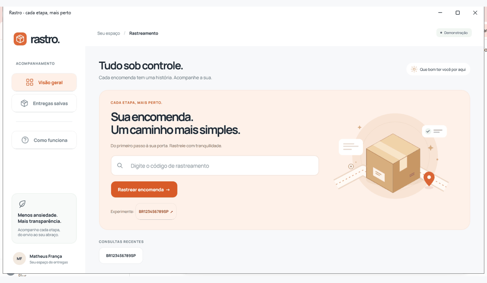

# rastro.

**Cada etapa, mais perto.** Aplicativo de rastreamento logístico em **.NET MAUI 10, XAML e MVVM**, desenvolvido para o Trabalho Prático 03 de CBTPRDM, IFSP Campus Cubatão.

**Dupla:** Matheus Correia França e Davi Leite Coelho — CB303142X.
**Professor:** Wellington Tuler Moraes.



[Tela inicial](docs/inicio.png) · [Rastreamento](docs/rastreamento.png) · [Histórico e localização](docs/historico.png) · [Layout compacto](docs/celular.png)

## Experiência

- Início com código de rastreamento, busca por Enter, exemplo interativo e consultas recentes.
- Painel com encomendas salvas, contadores e filtros por andamento ou entrega.
- Resultados com status, data de envio, previsão, origem, destino, última localização e histórico em ordem cronológica inversa.
- Linha de progresso, rota ilustrativa, copiar código, atualizar consulta e salvar/remover encomenda.
- Estados de carregamento, validação de formato, pacote inexistente, lista vazia e falha de armazenamento.
- Layout adaptável: navegação lateral no desktop, conteúdo empilhado em telas pequenas, fonte Manrope embarcada e ícones SVG próprios.
- Preferências e histórico persistidos no dispositivo, sem cadastro e sem serviços externos.

> **Demonstração acadêmica:** os dados são fictícios. A consulta assíncrona simula latência; o botão Atualizar consulta novamente a mesma fonte. Não há integração com transportadoras, geolocalização ou atualização em tempo real. O mapa representa uma rota ilustrativa. As datas de exemplo são calculadas ao iniciar a sessão, no horário de Brasília.

## Executar

Pré-requisitos: .NET SDK 10.0.401 ou versão compatível da linha 10, Visual Studio com ferramentas MAUI ou VS Code com extensão .NET MAUI. Instale a carga de trabalho da plataforma desejada. Android também exige Android SDK e JDK; emulador ou aparelho com depuração USB. iOS e Mac Catalyst exigem macOS/Xcode.

### Windows

```powershell
dotnet build src/Rastro.App/Rastro.App.csproj -p:RastroWindowsOnly=true -p:WindowsAppSDKSelfContained=true
& ./src/Rastro.App/bin/Debug/net10.0-windows10.0.19041.0/win-x64/Rastro.App.exe
```

O runtime de interface Windows é incluído pelo parâmetro `WindowsAppSDKSelfContained`. O runtime .NET 10 deve estar instalado. O aplicativo é executado sem empacotamento MSIX e não exige habilitar o modo de desenvolvedor do Windows.

### Android

Selecione `Rastro.App`, o destino Android e um dispositivo no Visual Studio. Pelo terminal, com SDK e dispositivo configurados:

```powershell
dotnet build src/Rastro.App/Rastro.App.csproj -f net10.0-android -t:Run
```

### Testes

```powershell
dotnet test tests/Rastro.Core.Tests/Rastro.Core.Tests.csproj
```

O projeto de testes depende apenas do .NET, sem emulador ou workload MAUI. Execute os testes e a compilação sequencialmente, pois compartilham os artefatos de `Rastro.Core`.

## Códigos para experimentar

| Código | Cenário |
| --- | --- |
| `BR123456789SP` | Em trânsito |
| `BR987654321SP` | Saiu para entrega |
| `BR456789123SP` | Entregue |
| `BR111222333SP` | Postado; permite experimentar salvar uma nova encomenda |
| `BR000000000SP` | Formato válido, encomenda não encontrada |

O formato demonstrativo é **2 letras + 9 números + 2 letras**. Letras minúsculas e espaços externos são normalizados. As três primeiras encomendas aparecem salvas no primeiro uso. Salvar e remover altera os contadores e persiste entre sessões. Os dados ficam em `FileSystem.AppDataDirectory/tracking.json`; removê-lo restaura a demonstração inicial.

## Organização

```text
src/
  Rastro.App/        Interface XAML, navegação nativa, DI e recursos visuais
    Controls/       Estrutura reutilizável e navegação adaptável
    Views/          HomePage e ResultsPage
    Services/       Adaptador de navegação e área de transferência
    Resources/      Tokens, estilos, fonte e SVGs
  Rastro.Core/       Núcleo independente da interface
    Models/         Package, PackageStatus e TrackingEvent
    ViewModels/     TrackingViewModel, comandos e notificações
    Services/       Contratos, simulação, validação e armazenamento JSON
tests/
  Rastro.Core.Tests/ Testes de comportamento do rastreamento
docs/               Requisitos, roteiro e evidências
scripts/            Geração reprodutível dos recursos visuais
```

O ViewModel expõe propriedades e comandos vinculados ao XAML. Serviços são recebidos por construtor. O code-behind trata somente dimensionamento e ciclo de vida. `ITrackingService` permite substituir a simulação por uma API sem alterar as telas. `ITrackingNavigation` isola navegação e clipboard do núcleo testável. A gravação JSON usa arquivo temporário, substituição atômica e exclusão mútua; arquivo ausente ou corrompido recupera os dados iniciais.

## Entrega

Consulte [requisitos e validação](docs/REQUISITOS.md) e [roteiro da demonstração](docs/ENTREGA.md). A fonte Manrope é distribuída sob a [SIL Open Font License](src/Rastro.App/Resources/Fonts/OFL-Manrope.txt). Ícones e ilustrações vetoriais originais podem ser regenerados com `python scripts/generate_assets.py`.

Referências técnicas: [XAML e MVVM no MAUI](https://learn.microsoft.com/dotnet/maui/xaml/), [bindings compilados](https://learn.microsoft.com/dotnet/maui/fundamentals/data-binding/compiled-bindings) e [execução Windows sem MSIX](https://learn.microsoft.com/dotnet/maui/windows/deployment/publish-unpackaged-cli).
